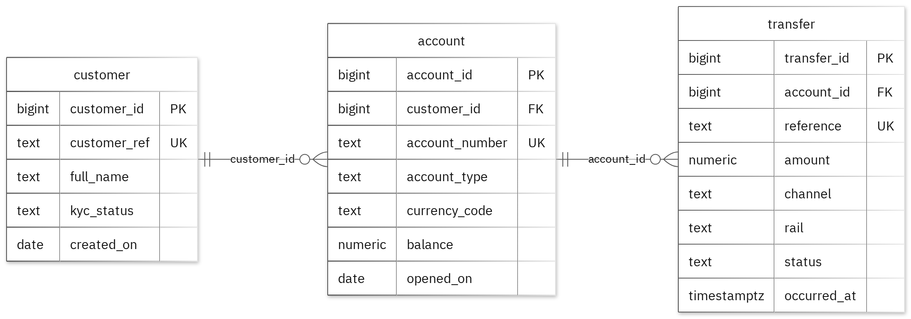
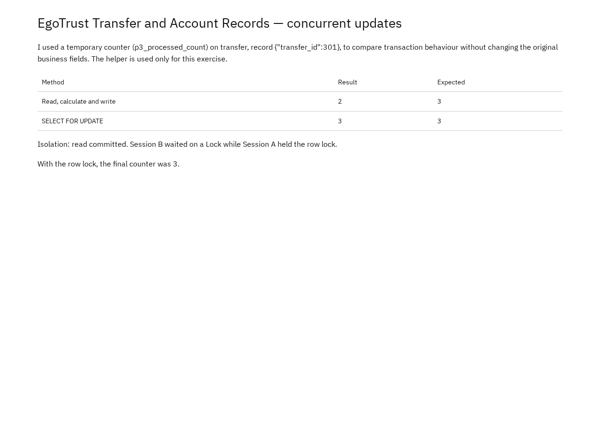

# MIT 8103 Advanced Database Systems — Practical Database Portfolio

**EgoTrust — Digital Banking and Payments Platform** · Ogokristi Oni · Student ID 301931440

**Repository:** https://github.com/tiwatee/ONI_OGOKRISTI_301931440

## Case Study

EgoTrust is a fictional Nigerian digital bank serving retail and SME customers through mobile, web, USSD, POS, ATM and branch channels. It onboards customers with KYC verification and runs savings, current and domiciliary accounts. It moves money between its own accounts, to other Nigerian banks through NIP, and across Africa through PAPSS. **Users:** customers, bank staff (tellers, relationship and branch managers), compliance officers, administrators and the external payment switches. **Major data:** customer profiles and BVNs, KYC documents, accounts and balances, an immutable transaction ledger, transfer records, branches and staff, and audit logs. **Key operations:** open accounts and verify KYC, transfer funds within EgoTrust and through NIP/PAPSS, reverse failed transactions, produce statements and compliance reports, and reconcile balances at the end of each day. I chose this case because I work on payment systems: a bank needs every topic in this module, from strict integrity and safe concurrency to fast reporting, flexible profile data and resilient distribution.

## Portfolio 1: Database Design and Modelling

I designed 8 PostgreSQL tables: branches, staff, customers, KYC documents, accounts, a transaction ledger, transfers and audit logs. They are connected by 13 relationships, including a recursive one (a reversal points at the transaction it reverses). The hardest modelling decision was interbank transfers. The receiving account belongs to another bank, so it cannot be a foreign key. I store the beneficiary's bank code and account number on the transfer instead, and a CHECK constraint requires them for NIP and PAPSS but an internal destination for intrabank transfers. Other rules are also enforced in the database: 11-digit BVNs, 10-digit NUBANs, no overdrafts, domiciliary accounts only in foreign currency, and a named verifier for verified KYC. **All 18 deliberately invalid statements in the constraint tests were rejected**, and the sample data was unchanged. The schema is in BCNF except for one documented exception: the balance snapshots on each ledger row, which I kept for auditability. The ER diagram is shown in Figure 1.

## Portfolio 2: Query Processing and Optimisation

I wrote 7 business queries: customer summaries, account statements, a failed-transfer report, channel volumes, a KYC compliance report, a window-function ranking and an audit trail. I examined each with `EXPLAIN ANALYZE`. On the small sample tables PostgreSQL correctly chose sequential scans, so I built a 500,000-row benchmark table to measure indexing. A composite index with the equality columns first and the date last cut the account-statement query **from 33.1 ms to 0.22 ms**. A covering index with `INCLUDE` produced an index-only scan with no heap fetches. A partial index on failed transactions was **456 kB against 19 MB** for the equivalent full index.

## Portfolio 3: Transactions and Concurrency

A single script demonstrates atomic transfers (COMMIT), a rejected overdraft that undoes an earlier credit (ROLLBACK), and a batch that survives one bad row (SAVEPOINT). I then ran two sessions concurrently against the same account, which started at NGN 1,500,000. With plain reads, one withdrawal was lost and the balance ended at **1,480,000 instead of 1,470,000**. With `SELECT … FOR UPDATE`, the second session waited about 1.5 seconds for the lock and the balance was correct. Under REPEATABLE READ the reader kept a consistent snapshot, and its update failed with a serialization error. Locking two accounts in opposite orders produced a real `deadlock detected`. Transfers avoid this by locking accounts in a fixed order.

Figure 1. EgoTrust ER diagram: 8 entities, 13 relationships (PK primary key, FK foreign key, UK unique).

## Portfolio 4: NoSQL and Advanced Data Models

I modelled EgoTrust's read-heavy data in MongoDB using three patterns, mirroring the PostgreSQL records and IDs. Customer profiles embed KYC documents and account summaries, so one read replaces three joins; SME customers carry extra business fields without schema changes. Transaction history uses per-account, per-day buckets updated by a single atomic upsert. Sessions use a key-value design with a TTL index that removes them automatically when they expire. Money is stored as Decimal128, and a `$jsonSchema` validator mirrors the SQL CHECK rules. Run on MongoDB 7.0, every query returned the expected documents, `explain()` confirmed an index scan, and the validator rejected an invalid transfer. The relational database remains the system of record for balances.

## Portfolio 5: Distributed and Cloud Database Exercise

I proposed (but did not deploy) a distributed design. Replication uses a synchronous standby for failover and asynchronous replicas for reporting. Sharding uses Citus, hashing on `account_id`, with a saga for cross-shard transfers. I listed the foreign keys sharding would force into application logic. In CAP terms, the ledger is **CP**: during a network partition it refuses transfers rather than risk a double debit. Sessions and profiles are **AP**. AWS's only Nigerian presence, the Lagos Local Zone, has no managed RDS. I therefore recommended a hybrid: the ledger self-managed in Lagos to meet data-residency requirements, and managed services in the Cape Town region where rules allow. On a single server I verified the replication checks and partition pruning.

Figure 2. Evidence from Portfolio 3: two psql sessions run concurrently. A lost update (1,480,000), a correct result with <code>FOR UPDATE</code> (1,470,000), a REPEATABLE READ serialization failure and a detected deadlock. Further evidence for every portfolio is in each folder's <code>screenshots/</code> on GitHub.

## Individual Reflection

The most useful lesson was that a database rule only counts if the database enforces it. My first transfer design looked tidy but could not represent a payment to another bank, and the constraint tests exposed that quickly. Normalisation also turned out to be a trade-off, not a goal: the stored balances break strict 3NF, but they make every ledger row self-contained evidence. The concurrency exercise made the lost-update problem concrete. Both sessions read the same balance, one customer's withdrawal silently disappeared, and the fix was a single `FOR UPDATE`. Checking execution plans rather than final answers showed that identical results can need very different amounts of work. One measurement surprised me: I expected the wrong-order index to be clearly slower, but with about 100 rows per account it made no difference. Indexing rules matter at scale, so they have to be tested with realistic data volumes.

## AI-Use Declaration

AI tools were used as supporting tools during the preparation of this portfolio. GitHub Copilot was used during the initial drafting stage, while Claude (Anthropic) assisted with refining the database design, developing and debugging SQL and MongoDB scripts, preparing documentation, and generating diagrams.

I was responsible for selecting and developing the case study, defining the database requirements, providing the Nigerian banking context (NIP, PAPSS, BVN, NUBAN, and KYC), and directing the implementation. I reviewed and refined the generated materials, executed the MongoDB script on MongoDB 7.0, and verified the resulting output, which is included as evidence. I take responsibility for the accuracy, understanding, and explanation of the submitted work.

## References

- PostgreSQL Global Development Group (2024) *PostgreSQL 16 Documentation*: constraints, EXPLAIN, indexes, transaction isolation, explicit locking, partitioning and replication. https://www.postgresql.org/docs/16/
- MongoDB Inc. (2024) *MongoDB Manual*: data modelling, schema validation, replication and sharding. https://www.mongodb.com/docs/manual/
- Citus Data (2024) *Citus Documentation*: distributed tables. https://docs.citusdata.com/
- Amazon Web Services (2024) *AWS Local Zones: Available Local Zones*. https://docs.aws.amazon.com/local-zones/latest/ug/available-local-zones.html
- Mermaid (2024) *Entity Relationship Diagrams* and *mermaid-cli*, used to draw Figure 1 and the Portfolio 5 architecture. https://mermaid.js.org/
- All people, BVNs, account numbers and transactions are fictional data created for this portfolio. No external datasets were used.
