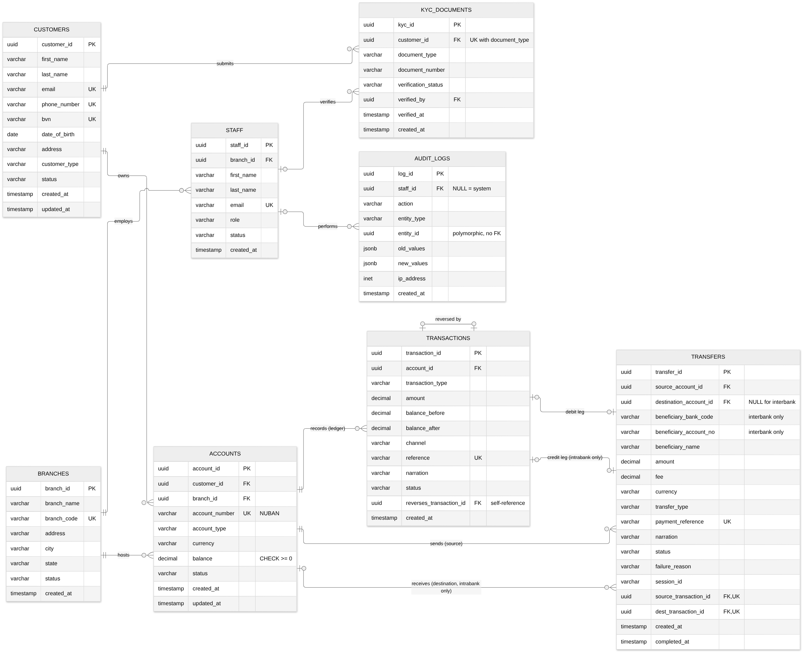

# EgoTrust — Digital Banking and Payments Platform

**MIT 8103 Advanced Database Systems · Practical Database Portfolio**
Ogokristi Oni · Student ID 301931440 · Miva Open University

📄 **[Final summary (PDF)](ONI_OGOKRISTI_301931440_FinalSummary.pdf)** · [Markdown version](ONI_OGOKRISTI_301931440_FinalSummary.md)

## Case Study

EgoTrust is a fictional Nigerian digital bank serving retail and SME customers through mobile, web, USSD, POS, ATM and branch channels. It onboards customers with KYC verification, runs savings, current and domiciliary accounts, and moves money between its own accounts, to other Nigerian banks through **NIP** and across Africa through **PAPSS**. Its users are customers, bank staff, compliance officers, system administrators and the external payment switches. All names, BVNs and account numbers in this repository are invented.

## Portfolios

| # | Portfolio | Highlights | Evidence |
|---|---|---|---|
| 1 | [Database Design and Modelling](portfolio-1-database-design/ONI_OGOKRISTI_301931440_P1_README.md) | 8 tables, 13 relationships, cross-column business rules, normalisation to BCNF; 18/18 invalid statements rejected | [constraint tests](portfolio-1-database-design/screenshots/ONI_OGOKRISTI_301931440_P1_DatabaseResults.png) |
| 2 | [Query Processing and Optimisation](portfolio-2-query-optimisation/ONI_OGOKRISTI_301931440_P2_README.md) | 7 queries with `EXPLAIN ANALYZE`; 500,000-row benchmark: 33.1 ms → 0.22 ms, index-only scan, partial index 40× smaller | [results](portfolio-2-query-optimisation/screenshots/ONI_OGOKRISTI_301931440_P2_QueryResults.png) · [plans](portfolio-2-query-optimisation/screenshots/ONI_OGOKRISTI_301931440_P2_IndexComparison.png) |
| 3 | [Transactions and Concurrency](portfolio-3-transactions-concurrency/ONI_OGOKRISTI_301931440_P3_README.md) | COMMIT / ROLLBACK / SAVEPOINT; two live sessions: lost update, `FOR UPDATE`, REPEATABLE READ conflict, deadlock | [commit/rollback](portfolio-3-transactions-concurrency/screenshots/ONI_OGOKRISTI_301931440_P3_CommitRollback.png) · [two sessions](portfolio-3-transactions-concurrency/screenshots/ONI_OGOKRISTI_301931440_P3_ConcurrencyResult.png) |
| 4 | [NoSQL and Advanced Data Models](portfolio-4-nosql/ONI_OGOKRISTI_301931440_P4_README.md) | MongoDB embedded, bucket and key-value (TTL) patterns; Decimal128 money; `$jsonSchema` validation | run with `mongosh` |
| 5 | [Distributed and Cloud Database Exercise](portfolio-5-distributed-cloud/ONI_OGOKRISTI_301931440_P5_README.md) | Replication, Citus sharding, CAP analysis, AWS design with Nigerian data residency (Lagos Local Zone) | [design](portfolio-5-distributed-cloud/screenshots/ONI_OGOKRISTI_301931440_P5_ProposedDesign.png) · [SQL output](portfolio-5-distributed-cloud/screenshots/ONI_OGOKRISTI_301931440_P5_PartitionAndRole.png) |



## Run Order

All SQL was tested on PostgreSQL 16. Start from an empty database:

```bash
psql -U postgres -c "CREATE DATABASE egotrust;"
cd portfolio-1-database-design
psql -U postgres -d egotrust -f ONI_OGOKRISTI_301931440_P1_Schema.sql
psql -U postgres -d egotrust -f ONI_OGOKRISTI_301931440_P1_SampleData.sql
psql -U postgres -d egotrust -f ONI_OGOKRISTI_301931440_P1_ConstraintTests.sql      # 18 expected errors
cd ../portfolio-2-query-optimisation
psql -U postgres -d egotrust -f ONI_OGOKRISTI_301931440_P2_Queries.sql
psql -U postgres -d egotrust -f ONI_OGOKRISTI_301931440_P2_Optimisation.sql         # run once
cd ../portfolio-3-transactions-concurrency
# two windows: follow the step numbers in SessionA.sql / SessionB.sql, then:
psql -U postgres -d egotrust -f ONI_OGOKRISTI_301931440_P3_Transactions.sql         # 2 expected errors
cd ../portfolio-5-distributed-cloud
psql -U postgres -d egotrust -f ONI_OGOKRISTI_301931440_P5_Replication.sql          # run once
cd ../portfolio-4-nosql
mongosh egotrust_nosql ONI_OGOKRISTI_301931440_P4_MongoDB.js
```

## AI Use

AI tools were used in preparing this portfolio; see the declaration in the [final summary](ONI_OGOKRISTI_301931440_FinalSummary.md#ai-use-declaration).
