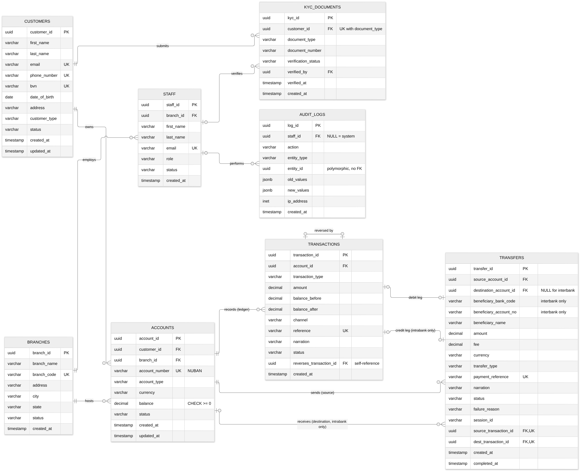
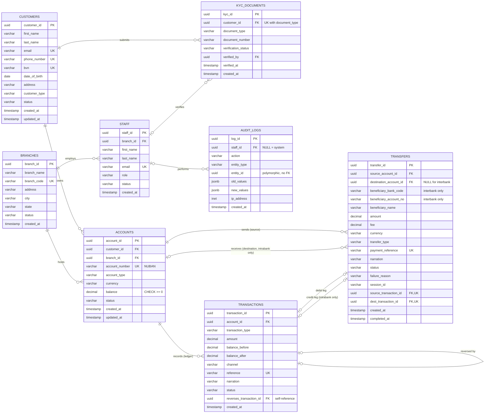

# EgoTrust — ER Diagram

Ogokristi Oni · Student ID 301931440 · MIT 8103 Portfolio 1

The image above is rendered from the Mermaid source below; GitHub also renders the source directly.

**Notation:** `||` exactly one · `|o` zero or one · `o{` zero or many. PK primary key, FK foreign key, UK unique key.

The 13 relationships, their cardinality and how each is enforced are listed in [the design document](ONI_OGOKRISTI_301931440_P1_Design.md#relationships-and-cardinality).
