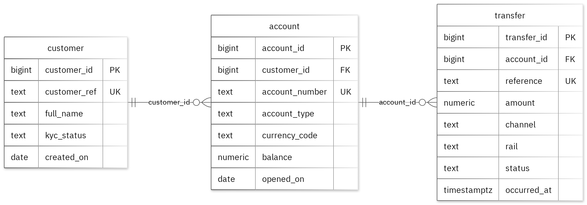
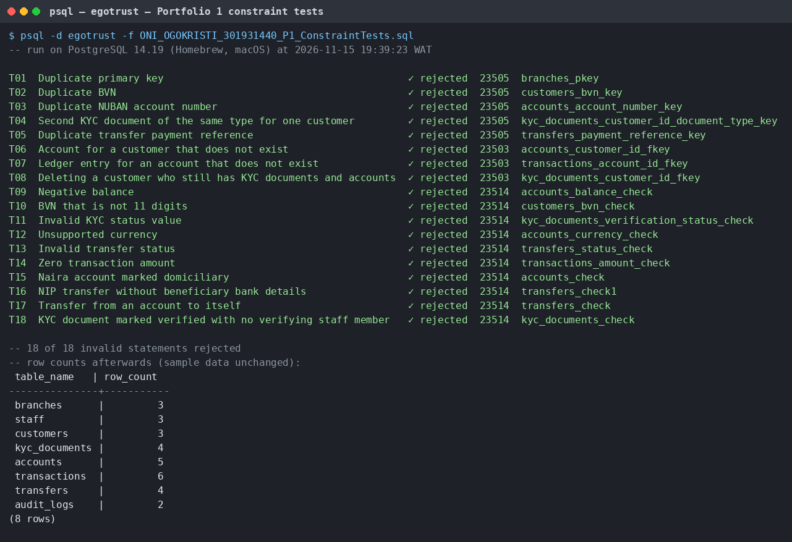

# Portfolio 1 — Database Design and Modelling

Ogokristi Oni · Student ID 301931440 · MIT 8103 Advanced Database Systems

I designed a relational database for EgoTrust, a fictional Nigerian digital bank. It has **8 tables** and **13 relationships**, and enforces the bank's rules in the database itself: keys, foreign keys, and both single-column and cross-column CHECK constraints.



## Files

| File | Contents |
|---|---|
| [Design](ONI_OGOKRISTI_301931440_P1_Design.md) | Case study, entities, relationship and cardinality table, design decisions, assumptions |
| [ER diagram](ONI_OGOKRISTI_301931440_P1_ERDiagram.md) | Diagram image and Mermaid source |
| [Normalisation](ONI_OGOKRISTI_301931440_P1_Normalisation.md) | 1NF → 2NF → 3NF → BCNF analysis, plus the one deliberate denormalisation and how its risk is controlled |
| [Schema](ONI_OGOKRISTI_301931440_P1_Schema.sql) | PostgreSQL DDL: tables, keys, constraints, indexes |
| [Sample data](ONI_OGOKRISTI_301931440_P1_SampleData.sql) | Fictional, internally consistent records |
| [Constraint tests](ONI_OGOKRISTI_301931440_P1_ConstraintTests.sql) | 18 deliberately invalid statements, one per rule |
| [Evidence](screenshots/ONI_OGOKRISTI_301931440_P1_DatabaseResults.png) | Output of the constraint tests and row counts |

## Results

**Sample data:** 3 branches, 3 staff, 3 customers, 4 KYC documents, 5 accounts, 6 transactions, 4 transfers (successful intrabank, successful NIP, failed NIP, pending PAPSS) and 2 audit-log entries. Every account balance equals the `balance_after` of its latest ledger entry.

**Constraint tests:** all **18** invalid statements were rejected by the intended constraint, and the row counts were unchanged afterwards.

| Group | Tests | Examples |
|---|---|---|
| Keys | T01–T05 | duplicate BVN, duplicate NUBAN, duplicate payment reference |
| Referential integrity | T06–T08 | account for a non-existent customer; deleting a customer who still has accounts |
| Domain rules | T09–T14 | negative balance, 5-digit BVN, KYC status `banana`, currency `XYZ`, transfer status `maybe` |
| Business rules | T15–T18 | NGN domiciliary account, NIP transfer with no beneficiary bank, self-transfer, "verified" KYC with no verifier |



## Run It

```bash
psql -U postgres -c "CREATE DATABASE egotrust;"
psql -U postgres -d egotrust -f ONI_OGOKRISTI_301931440_P1_Schema.sql
psql -U postgres -d egotrust -f ONI_OGOKRISTI_301931440_P1_SampleData.sql
psql -U postgres -d egotrust -f ONI_OGOKRISTI_301931440_P1_ConstraintTests.sql   # expect 18 errors
```

Run on PostgreSQL 14.19 on my Mac (the evidence above, raw output in [`ONI_OGOKRISTI_301931440_P1_Output.txt`](ONI_OGOKRISTI_301931440_P1_Output.txt)); also tested on PostgreSQL 16.

## References

- [PostgreSQL — Constraints](https://www.postgresql.org/docs/16/ddl-constraints.html)
- [Mermaid — Entity Relationship Diagrams](https://mermaid.js.org/syntax/entityRelationshipDiagram.html)
