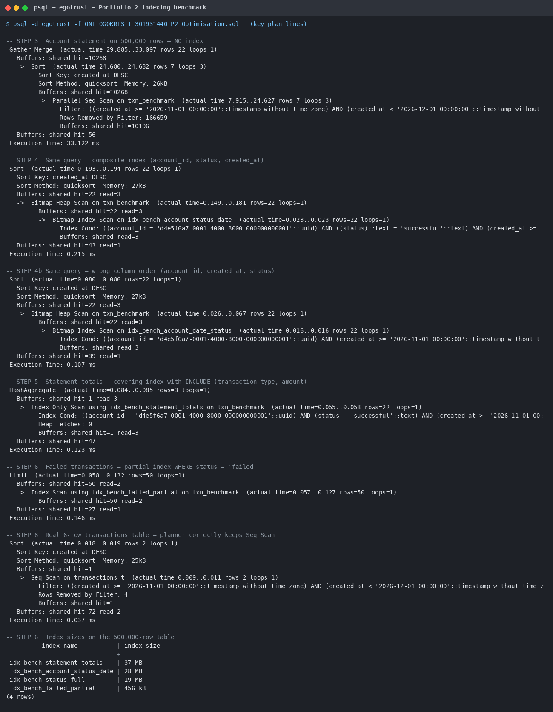
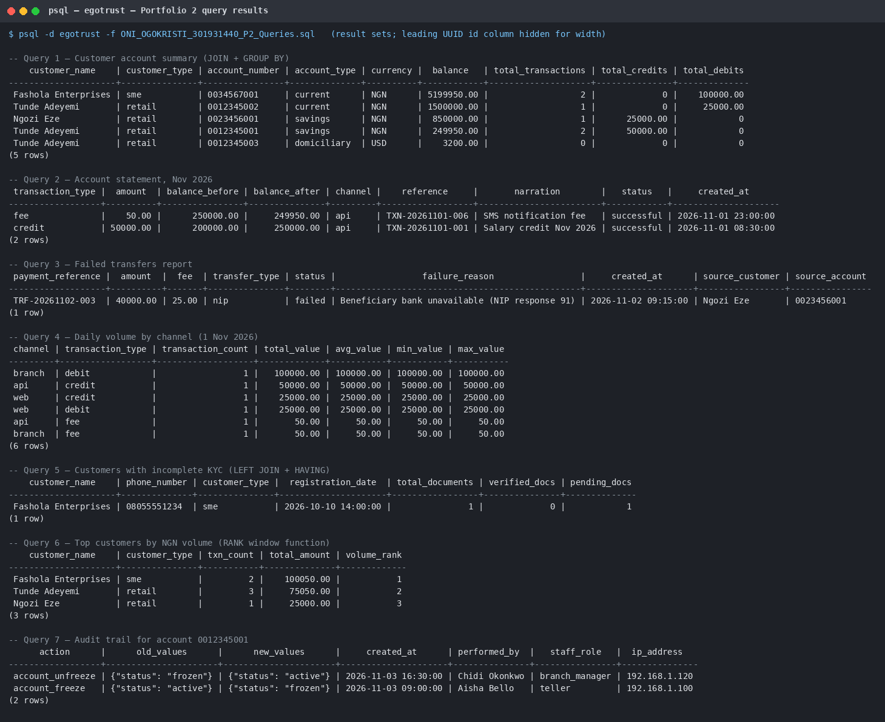

# Portfolio 2 — Query Processing and Optimisation

## EgoTrust — Digital Banking & Payments Platform

**Student:** Ogokristi Oni · Student ID 301931440  
**Module:** MIT 8103 — Advanced Database Systems  
**Institution:** Miva Open University  

---

## Overview

This portfolio demonstrates query processing, execution plan analysis, and indexing optimisation strategies using the EgoTrust PostgreSQL database. Seven business-critical queries are analysed with `EXPLAIN ANALYZE`, followed by targeted index creation to improve performance.

## Files

| File | Description |
|------|-------------|
| `ONI_OGOKRISTI_301931440_P2_Queries.sql` | 7 analytical SQL queries with EXPLAIN ANALYZE |
| `ONI_OGOKRISTI_301931440_P2_Optimisation.sql` | Index creation script with before/after comparison |
| [Query results](screenshots/ONI_OGOKRISTI_301931440_P2_QueryResults.png) · [Index comparison](screenshots/ONI_OGOKRISTI_301931440_P2_IndexComparison.png) | Output captured from running both scripts |

## Queries Implemented

### Query 1: Customer Account Summary
- **Purpose:** Aggregate view of each customer's accounts, balances, and transaction counts
- **Techniques:** Multi-table JOIN, GROUP BY, aggregate functions (SUM, COUNT)
- **Business Use:** Customer relationship management dashboard

### Query 2: Transaction History by Date Range
- **Purpose:** Retrieve filtered transaction records for a specific account
- **Techniques:** WHERE clause filtering on composite conditions, ORDER BY
- **Business Use:** Account statement generation, dispute resolution

### Query 3: Failed Transfers Report
- **Purpose:** Identify failed NIP/PAPSS transfers with source customer details
- **Techniques:** Multi-table JOIN (transfers → accounts → customers), status filtering
- **Business Use:** Operations monitoring, failure rate analysis

### Query 4: Daily Transaction Volume by Channel
- **Purpose:** Aggregate transaction volumes grouped by date and channel
- **Techniques:** DATE() extraction, GROUP BY with multiple dimensions, aggregate functions
- **Business Use:** Channel performance monitoring, capacity planning

### Query 5: KYC Compliance Report
- **Purpose:** Identify customers with incomplete identity verification
- **Techniques:** LEFT JOIN, HAVING clause with COUNT filter
- **Business Use:** Regulatory compliance, CBN KYC audit preparation

### Query 6: Top Customers by Transaction Volume
- **Purpose:** Rank customers by total transaction value using window functions
- **Techniques:** Subquery, RANK() window function, aggregate in subquery
- **Business Use:** VIP customer identification, relationship management

### Query 7: Audit Trail for Specific Account
- **Purpose:** Retrieve chronological audit log for a given account
- **Techniques:** JOIN with staff table, JSONB column access, entity-type filtering
- **Business Use:** Security investigation, compliance audit trail

## Indexing Strategy

### Existing Indexes (from Portfolio 1's schema)
PostgreSQL automatically creates a unique B-tree index for every PRIMARY KEY and UNIQUE constraint (BVN, account number, transaction reference, payment reference). The schema adds explicit indexes only on foreign keys and common filter columns, which PostgreSQL does not index automatically.

### Benchmark Method
The seed data has only a few rows per table, and on tables that small PostgreSQL correctly prefers a sequential scan. `ONI_OGOKRISTI_301931440_P2_Optimisation.sql` therefore builds a separate 500,000-row `txn_benchmark` table (5,000 accounts, about 100 rows each, Sep–Dec 2026), measures each query before and after indexing, and only then applies the chosen indexes to the real tables.

### Measured Results (PostgreSQL 16.15, the run shown in the evidence image)

| Test | Plan | Execution time |
|------|------|----------------|
| Query 2 (account statement), no index | Parallel Seq Scan over 500,000 rows | 33.1 ms |
| Query 2 with `(account_id, status, created_at)` | Bitmap Index Scan, 22 rows read | 0.22 ms |
| Query 2 with the wrong column order `(account_id, created_at, status)` | Bitmap Index Scan | 0.11 ms |
| Statement totals with `INCLUDE (transaction_type, amount)` | **Index Only Scan**, Heap Fetches: 0 | 0.12 ms |
| Failed-transactions list, partial index | Index Scan on the partial index | 0.15 ms |
| Query 2 on the real 6-row table, after indexing | Seq Scan (correctly chosen by the planner) | 0.04 ms |

| Index size comparison | Size |
|---|---|
| Partial `(created_at) WHERE status = 'failed'` | 456 kB |
| Full `(status, created_at)` | 19 MB |

The composite index cut Query 2 from 33.1 ms to 0.22 ms, about **150 times faster**. Across repeated runs the unindexed time varied between about 33 and 42 ms. The partial index is about **40 times smaller** than the equivalent full index.

The wrong-order index was not slower here (0.11 ms against 0.22 ms). Each account has only about 100 rows, so both scans touch a handful of index entries and the gap is just timing noise. The column-order rule matters for busy accounts with thousands of rows per month. There, `(account_id, created_at, status)` must walk every status inside the date range, while `(account_id, status, created_at)` jumps straight to the matching rows.



### Indexes Applied to the Real Schema
| Index | Table | Type | Rationale |
|-------|-------|------|-----------|
| `idx_txn_account_status_date` | transactions | Composite B-tree | Query 2: equality columns (`account_id`, `status`) first, then the range column (`created_at`) |
| `idx_transfers_failed` | transfers | Partial B-tree | Query 3: failures are a small fraction of transfers, so only those rows are indexed |
| `idx_txn_successful_date_channel` | transactions | Partial composite | Query 4: pre-filters to successful transactions, ordered by date then channel |
| `idx_audit_entity_date` | audit_logs | Composite B-tree | Query 7: adds the sort column; replaces the old `idx_audit_entity`, which it makes redundant |
| `idx_kyc_pending` | kyc_documents | Partial B-tree | Query 5: the compliance queue of pending documents |

### Optimisation Principles Applied

1. **Composite index column order**: equality predicates first, range/sort predicates last. An index on `(account_id, created_at, status)` forces the scan to walk every status within the date range. `(account_id, status, created_at)` narrows on both equality columns before the range scan (tested in STEP 4b).
2. **Partial indexes**: used where queries always filter on a known value such as `status = 'failed'`. This reduces index size, cache footprint, and write cost.
3. **Covering indexes**: an index-only scan needs **every column the query reads** (SELECT list as well as WHERE) to be in the index. Indexing only the WHERE columns is not enough. `INCLUDE` adds payload columns without making them search keys, and `VACUUM` must have updated the visibility map.
4. **Avoiding redundant indexes**: an index whose columns are a leading prefix of another index is dropped, because it costs writes without speeding up reads.
5. **ANALYZE after indexing**: refreshes planner statistics so new indexes are costed correctly.

## How to Run

```bash
# Load Portfolio 1's schema and sample data into a fresh egotrust database first
psql -U postgres -d egotrust -f ONI_OGOKRISTI_301931440_P2_Queries.sql                 # execution plans
psql -U postgres -d egotrust -f ONI_OGOKRISTI_301931440_P2_Optimisation.sql   # benchmark + indexes
```

Run `ONI_OGOKRISTI_301931440_P2_Optimisation.sql` once only on a given database, because it creates and drops indexes on the real tables.

## Interpreting the Real-Table Plans

On the real seed tables, plans still show `Seq Scan` after indexing. That is the cost-based optimiser working correctly: reading one 8 KB page is cheaper than walking an index. The benchmark table shows how the same queries behave at production volume.

The `BUFFERS` output in EXPLAIN ANALYZE shows shared buffer hits and reads. This is the I/O measure that matters most in production tuning.

## Query Results (evidence)



## References

- [PostgreSQL — Using EXPLAIN](https://www.postgresql.org/docs/16/using-explain.html)
- [PostgreSQL — Multicolumn, Partial and Index-Only Scans](https://www.postgresql.org/docs/16/indexes.html)
