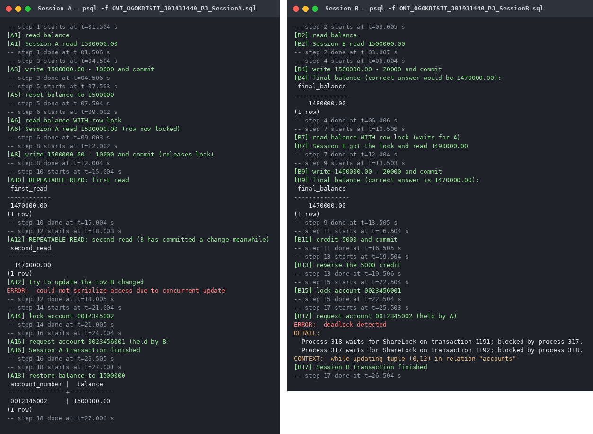
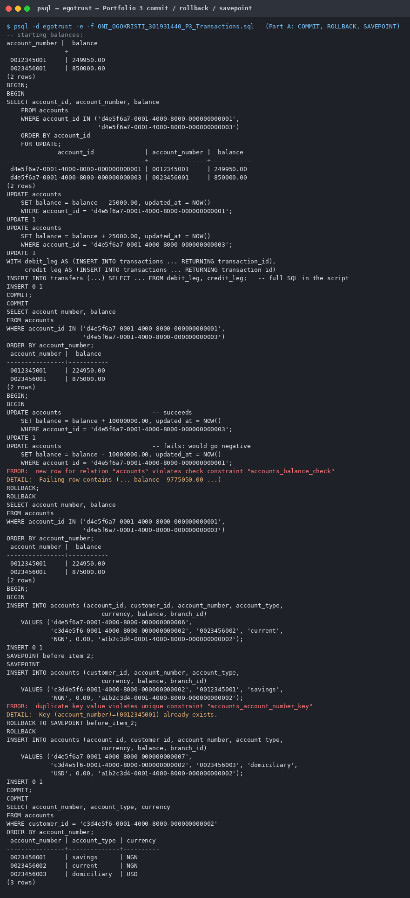

# Portfolio 3 — Transactions and Concurrency Control

## EgoTrust — Digital Banking & Payments Platform

**Student:** Ogokristi Oni · Student ID 301931440  
**Module:** MIT 8103 — Advanced Database Systems  
**Institution:** Miva Open University  

---

## Overview

This portfolio demonstrates transaction management, isolation levels, and concurrency control mechanisms in PostgreSQL, applied to realistic banking scenarios in the EgoTrust platform. Banking is one of the most demanding domains for transaction integrity — a single lost update or phantom read can result in financial loss.

## Files

| File | Description |
|------|-------------|
| [`ONI_OGOKRISTI_301931440_P3_Transactions.sql`](ONI_OGOKRISTI_301931440_P3_Transactions.sql) | Single-session script: COMMIT, ROLLBACK, SAVEPOINT, isolation levels, locking patterns |
| [`ONI_OGOKRISTI_301931440_P3_SessionA.sql`](ONI_OGOKRISTI_301931440_P3_SessionA.sql) / [`ONI_OGOKRISTI_301931440_P3_SessionB.sql`](ONI_OGOKRISTI_301931440_P3_SessionB.sql) | Two-session scripts with numbered steps: lost update, `FOR UPDATE`, REPEATABLE READ conflict, deadlock |
| [Commit/rollback evidence](screenshots/ONI_OGOKRISTI_301931440_P3_CommitRollback.png) · [Concurrency evidence](screenshots/ONI_OGOKRISTI_301931440_P3_ConcurrencyResult.png) | Output captured from running the scripts on PostgreSQL 16 |

## Two-Session Results (run concurrently)

Both sessions work on account 0012345002, which starts at NGN 1,500,000. Session A withdraws 10,000 and Session B withdraws 20,000, so the correct final balance is **1,470,000**. Each session reads the balance into a psql variable (`\gset`), then writes "what I read minus my amount". This is the read-calculate-write pattern an application performs.

| Scenario | What happened | Final balance |
|---|---|---|
| 1. No locking (READ COMMITTED) | Both read 1,500,000. A wrote 1,490,000, then B overwrote it with 1,480,000. **A's withdrawal was lost.** | 1,480,000 ✗ |
| 2. `SELECT … FOR UPDATE` | B's read **waited ~1.5 s** until A committed, then read 1,490,000 and wrote 1,470,000 | 1,470,000 ✓ |
| 3. REPEATABLE READ | A read the same balance twice, even though B committed a change in between (snapshot). A's update then failed: `could not serialize access due to concurrent update` | unchanged ✓ |
| 4. Deadlock | A locked 0012345002 then wanted 0023456001; B did the reverse. PostgreSQL reported `deadlock detected` and aborted B, and A then completed | no partial change ✓ |

The last step restores the account to 1,500,000, so the ledger still reconciles.



## Part A: Basic Transaction Operations

### A1 — Successful Intrabank Transfer (COMMIT)
Demonstrates **atomicity**. Tunde Adeyemi sends NGN 25,000 to Ngozi Eze. The transaction locks both accounts in a fixed order, debits one, credits the other, writes both ledger legs, and inserts the `transfers` row linking to those legs. All of these happen together or none do. Result: 0012345001 goes from 249,950 to 224,950, and 0023456001 from 850,000 to 875,000.

### A2 — Failed Transfer (ROLLBACK)
The credit runs first and succeeds. The debit then violates `CHECK (balance >= 0)` and PostgreSQL aborts the transaction, so the earlier credit is also undone. **Expected output:** `ERROR: new row for relation "accounts" violates check constraint "accounts_balance_check"`, followed by unchanged balances.

### A3 — SAVEPOINT for Partial Rollback
A batch opens three accounts, and the second has a duplicate NUBAN. In PostgreSQL any error puts the whole transaction into an aborted state. `ROLLBACK TO SAVEPOINT` discards only the failed item, so items 1 and 3 still commit. **Expected output:** `ERROR: duplicate key value violates unique constraint "accounts_account_number_key"`, after which Ngozi Eze has three accounts.

## Part B: Isolation Levels

| Level | PostgreSQL Behaviour | EgoTrust Use Case |
|-------|---------------------|-------------------|
| READ COMMITTED | Default. Each statement sees latest committed data | General operations, balance enquiries |
| REPEATABLE READ | Snapshot at transaction start. All reads see same data | Account statement generation |
| SERIALIZABLE | Full serializability via SSI | End-of-day settlement, regulatory reporting |

### Key Concepts Demonstrated

- **Non-repeatable reads** — In READ COMMITTED, two identical SELECTs in the same transaction may return different results if another transaction commits between them
- **Snapshot isolation** — REPEATABLE READ ensures a consistent view for the entire transaction, critical for generating accurate financial reports
- **Serializable Snapshot Isolation (SSI)** — PostgreSQL's implementation of SERIALIZABLE uses predicate locking rather than full table locks, maintaining high concurrency while guaranteeing correctness

## Part C: Concurrency Control

### C1 — Pessimistic Locking (SELECT ... FOR UPDATE)
Locks the account row before an ATM withdrawal, preventing the **lost update** anomaly: two sessions reading the same balance and each subtracting from it. A second session running the same block waits until the first commits.

### C2 — SKIP LOCKED for Queue Processing
A worker claims the oldest pending transfer (the seeded PAPSS transfer) and marks it `processing` in a single `UPDATE ... WHERE transfer_id = (SELECT ... FOR UPDATE SKIP LOCKED LIMIT 1)`. Concurrent workers skip rows that are already claimed, so they never block each other or process the same transfer twice.

### C3 — Advisory Locks
Application-level mutual exclusion with `pg_try_advisory_lock()`, which returns `false` instead of waiting. A second end-of-day scheduler instance can detect the job is already running and exit.

### C4 — Deadlock Awareness
A two-session script (laid out side by side in the comments) where opposite-direction transfers deadlock. PostgreSQL detects the cycle after `deadlock_timeout` and aborts one session with `ERROR: deadlock detected`. Prevention is shown in A1: lock all affected accounts with `ORDER BY account_id FOR UPDATE` before changing any of them.

## Part D: Lock Monitoring

A diagnostic query against `pg_locks` and `pg_stat_activity` for observing active locks during concurrent operations. This is a critical operational tool for identifying lock contention in production.

## ACID Properties in EgoTrust

| Property | How It's Demonstrated |
|----------|----------------------|
| **Atomicity** | Transfer debits and credits succeed or fail together (A1, A2) |
| **Consistency** | CHECK constraints prevent negative balances; UNIQUE prevents duplicate accounts (A3) |
| **Isolation** | Three isolation levels shown with banking use cases (B1–B3) |
| **Durability** | PostgreSQL's WAL (Write-Ahead Log) ensures committed transactions survive crashes |

## How to Run

```bash
# Ensure the egotrust database exists with schema and seed data loaded
# after loading Portfolio 1's schema and sample data:
psql -U postgres -d egotrust -f ONI_OGOKRISTI_301931440_P3_Transactions.sql
```

**Notes:**
- Run on a freshly seeded database. A2 and A3 each produce one **intended** error, so do not run with `ON_ERROR_STOP=1`.
- For the two-session scenarios, open two `psql` windows on the same database. Follow the step numbers across `SessionA.sql` and `SessionB.sql` (1 in A, 2 in B, 3 in A, …). Steps 7 and 16/17 will visibly pause; that pause is the lock wait.
- Part D (lock monitoring) is most useful when run from a third window while one session is paused inside a transaction.



## References

- [PostgreSQL — Transaction Isolation](https://www.postgresql.org/docs/16/transaction-iso.html)
- [PostgreSQL — Explicit Locking](https://www.postgresql.org/docs/16/explicit-locking.html)
