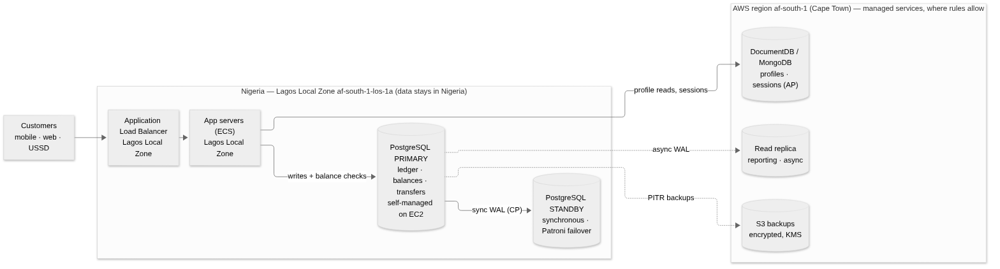
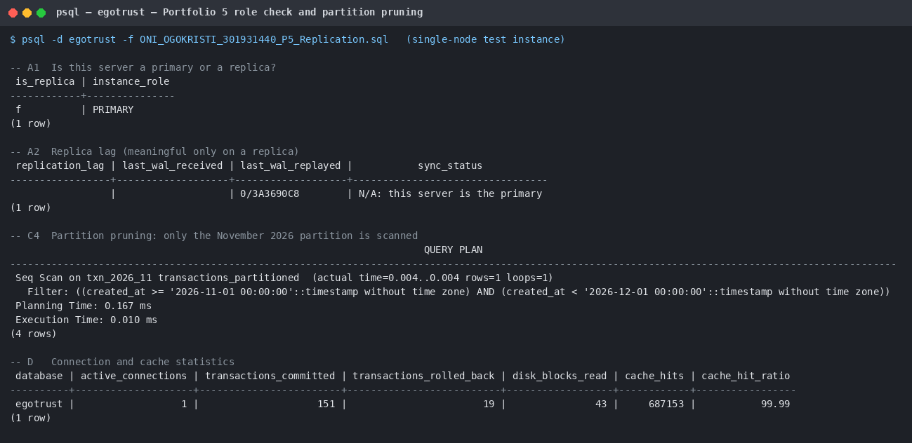

# Portfolio 5 — Distributed and Cloud Database Exercise

## EgoTrust — Digital Banking & Payments Platform

**Student:** Ogokristi Oni · Student ID 301931440  
**Module:** MIT 8103 — Advanced Database Systems  
**Institution:** Miva Open University  

---

## Overview

This portfolio proposes how EgoTrust's databases would scale to a distributed, cloud-hosted environment on Amazon Web Services (AWS). It covers replication, sharding, the CAP theorem, data residency and a cloud deployment architecture. This is a **design exercise**: no cloud resources were provisioned and no failover test was run. The replication-monitoring and partitioning SQL **was** run on a single PostgreSQL 16 instance (evidence below).

| File | Contents |
|---|---|
| `ONI_OGOKRISTI_301931440_P5_README.md` | This design document |
| [`ONI_OGOKRISTI_301931440_P5_Replication.sql`](ONI_OGOKRISTI_301931440_P5_Replication.sql) | Primary/replica checks, replication-lag and slot monitoring, read/write routing, monthly table partitioning |
| [Proposed design](screenshots/ONI_OGOKRISTI_301931440_P5_ProposedDesign.png) · [Role check and partition pruning](screenshots/ONI_OGOKRISTI_301931440_P5_PartitionAndRole.png) | Architecture diagram; output from running the SQL |



*Figure: the recommended hybrid (Option C in Section 4). The ledger stays in Nigeria on self-managed PostgreSQL in the AWS Lagos Local Zone, with a synchronous standby. Managed services in the Cape Town region hold reporting replicas, profile and session data, and backups, wherever the residency rules allow.*

---

## 1. Replication Strategy

### Primary-Replica (Master-Slave) Replication

EgoTrust uses PostgreSQL streaming replication with one primary and two read replicas.

```
┌──────────────┐   sync    ┌──────────────┐
│   PRIMARY    │──────────▶│   STANDBY    │  (no reads; automatic failover)
│  (Write)     │           │  AZ b        │
│  AZ a        │           └──────────────┘
└──────┬───────┘
       │ async WAL stream
       ├──────────────────▶┌──────────────┐
       │                   │  REPLICA 1   │  (read-only: statements,
       │                   │  AZ a        │   dashboards)
       │                   └──────────────┘
       └──────────────────▶┌──────────────┐
                           │  REPLICA 2   │  (read-only: reporting,
                           │  AZ c / DR   │   disaster recovery)
                           └──────────────┘
```

**Configuration (Amazon RDS for PostgreSQL, Africa (Cape Town) region `af-south-1`):**
- **Primary instance:** `db.r6g.xlarge` (4 vCPU, 32 GiB RAM), Multi-AZ, with a synchronous standby in a second AZ
- **Read Replica 1:** asynchronous, same AZ as the primary for low-latency read offloading
- **Read Replica 2:** asynchronous, in a third AZ, or cross-region for disaster recovery (subject to the data-residency constraints in Section 4)

AWS has no full region in Nigeria. The **Lagos Local Zone** (`af-south-1-los-1a`) is an extension of `af-south-1` that offers EC2, EBS, ECS, EKS, Application Load Balancer and Direct Connect, but **not** RDS. Section 4 discusses what this means for EgoTrust.

### Replication Use Cases in EgoTrust

| Operation | Target | Reason |
|-----------|--------|--------|
| Fund transfers, balance updates | Primary | Write consistency required |
| Account statement generation | Replica 1 | Read-heavy, can tolerate slight lag |
| Regulatory reporting | Replica 2 | Long-running queries without impacting production |
| Mobile app dashboard | Replica 1 | High-traffic reads offloaded from primary |
| Disaster recovery failover | Replica 2 | Automatic promotion if primary fails |

### Replication Lag Monitoring

```sql
-- Check replication lag on replica
SELECT
    now() - pg_last_xact_replay_timestamp() AS replication_lag,
    pg_is_in_recovery() AS is_replica,
    pg_last_wal_receive_lsn() AS last_received,
    pg_last_wal_replay_lsn() AS last_replayed;
```

For EgoTrust, acceptable replication lag is:
- **< 100ms** for account dashboards (Replica 1, same AZ)
- **< 5 seconds** for reporting (Replica 2, cross-region)
- **0ms** for balance checks before transfers (always read from Primary)

---

## 2. Sharding Strategy

### Horizontal Sharding by Account ID

As EgoTrust grows to millions of customers, a single PostgreSQL instance cannot handle the write throughput. Sharding distributes data across multiple database nodes.

**Shard Key:** `account_id` (UUID), **hash-distributed**

```
                    ┌──────────────────┐
                    │ Citus coordinator│  routes each query by
                    │                  │  hash(account_id)
                    └────────┬─────────┘
              ┌──────────────┼──────────────┐
              ▼              ▼              ▼
        ┌───────────┐  ┌───────────┐  ┌───────────┐
        │ Worker A  │  │ Worker B  │  │ Worker C  │
        │ hash range│  │ hash range│  │ hash range│
        │ 1 of 3    │  │ 2 of 3    │  │ 3 of 3    │
        └───────────┘  └───────────┘  └───────────┘
```

Citus hashes the shard-key value to a 32-bit integer and assigns hash ranges to shards (32 shards by default), which it spreads across worker nodes. Because the UUID is hashed rather than range-split, accounts are distributed evenly no matter when they were created. (pgpool-II is a connection pooler and load balancer, not a sharding router, so it is not used for this.)

**Why UUID as shard key:**
- Uniform distribution across shards (no hotspots)
- The schema already uses UUIDs (designed in Portfolio 1 for this purpose)
- Account-scoped queries (transfers, transactions, statements) hit a single shard
- No need for cross-shard JOINs for the most common operations

### Shard-Friendly vs Cross-Shard Queries

| Query Type | Shard Behaviour | Example |
|------------|----------------|---------|
| Account balance lookup | Single shard | `WHERE account_id = '...'` |
| Transaction history | Single shard | `WHERE account_id = '...' AND created_at > ...` |
| Internal transfer | Two shards (if different) | Debit shard A, credit shard B |
| Customer search by name | Cross-shard (scatter-gather) | `WHERE last_name = 'Okafor'` |
| Daily settlement report | Cross-shard (aggregation) | `SUM(balance) FROM accounts` |

**Handling Cross-Shard Transfers:**
Internal transfers between accounts on different shards require a distributed transaction. EgoTrust uses the **saga pattern**:

1. **Reserve** — Debit source account on Shard A (mark as "pending")
2. **Execute** — Credit destination account on Shard B
3. **Confirm** — Mark source debit as "successful" on Shard A
4. **Compensate** (on failure) — Reverse the debit on Shard A if Step 2 fails

### Implementation with Citus (PostgreSQL Extension)

```sql
-- Reference tables: small, rarely changed, copied to every worker,
-- so any shard can join to them locally
SELECT create_reference_table('branches');
SELECT create_reference_table('staff');
SELECT create_reference_table('customers');

-- Distributed tables, co-located on the same hash of account_id so an
-- account and its ledger always live on the same worker
SELECT create_distributed_table('accounts', 'account_id');
SELECT create_distributed_table('transactions', 'account_id',
                                colocate_with => 'accounts');
SELECT create_distributed_table('transfers', 'source_account_id',
                                colocate_with => 'accounts');
```

**Schema changes required before distributing** (this is the honest cost of sharding the Portfolio 1 design):

| Constraint in Portfolio 1 | Problem under Citus | Change |
|---|---|---|
| `transactions` PK `(transaction_id)` | Unique constraints on a distributed table must include the distribution column | PK becomes `(account_id, transaction_id)`; `reference` unique becomes `(account_id, reference)`, and global uniqueness of references comes from UUID-based generation |
| `transfers.destination_account_id → accounts` | FKs between distributed tables must use the co-located distribution column; the destination may be on another shard | FK dropped; destination validated by the application/saga |
| `transfers.source_transaction_id`, `dest_transaction_id → transactions` | Same: the credit leg lives on the destination's shard | Source-leg FK kept as `(source_account_id, source_transaction_id)`; destination-leg FK dropped |
| `customers` as a normal table | Customer data is needed for joins on every shard | Made a reference table. At very large scale it would be distributed by `customer_id`, with accounts co-located by customer instead |

This shows a general principle: sharding trades some database-enforced integrity for horizontal scale, and the application has to take over the checks the database can no longer do across shards.

---

## 3. CAP Theorem Analysis

The CAP theorem states that a distributed database can guarantee at most two of three properties: **Consistency**, **Availability**, and **Partition Tolerance**.

### EgoTrust's Position on the CAP Triangle

```
                     Consistency (C)
                          /\
                         /  \
     CA: single-node    /    \   CP: EgoTrust ledger
     PostgreSQL (no    /      \  (balances, transfers,
     partitions to    /        \  audit logs)
     tolerate)       /          \
                    /____________\
        Availability (A)         Partition tolerance (P)
                   AP: EgoTrust session store,
                   profile cache, notifications
```

Each edge of the triangle is a pair of guarantees. In any distributed system network partitions will happen, so P is not optional. The real choice, made per service, is **C or A during a partition**. CA only describes a single node, which cannot partition from itself.

### CP (Consistency + Partition Tolerance) — Financial Transactions

EgoTrust's core banking operations (balances, transfers) choose **consistency over availability**. During a network partition:
- The system refuses to process transfers rather than risk double-spending
- Account balances are always accurate, even if the service is temporarily unavailable
- This aligns with banking regulations (CBN guidelines) requiring accurate records

**Implementation:** synchronous replication to the Multi-AZ standby: the primary does not acknowledge a commit until the standby has it. If the standby is unreachable, writes block rather than diverge, which is the CP choice. (In self-managed PostgreSQL this is `synchronous_commit = on` with `synchronous_standby_names` set.) The read replicas remain asynchronous, so reads that must be current (balance before a debit) go to the primary.

### AP (Availability + Partition Tolerance) — Session Store

EgoTrust's MongoDB session store (Portfolio 4) prioritises **availability**. During a partition:
- Users can still log in and view cached data
- Session tokens may be slightly stale but the service remains accessible
- Eventual consistency is acceptable — a session expiring 30 seconds late is tolerable

**Implementation:** MongoDB replica set with `readPreference: nearest` and `writeConcern: { w: 1 }`. A write is acknowledged by whichever node accepts it, and reads come from the closest node even if it is slightly behind. (Using `w: "majority"` would move the session store back toward CP: writes would fail if a majority of nodes could not be reached.)

### Practical Trade-offs

| Service | CAP Choice | Justification |
|---------|-----------|---------------|
| Balance enquiry | CP | Must always return accurate balance |
| Fund transfer | CP | Cannot risk double-debit or lost credit |
| Transaction history | CP (relaxed) | Slight lag acceptable for read replicas |
| Customer profile view | AP | Cached profile acceptable during partition |
| Session management | AP | Availability more important than perfect consistency |
| Push notifications | AP | Delayed/duplicate notification is acceptable |
| Audit logs | CP | Regulatory requirement for complete, accurate records |

---

## 4. Cloud Deployment Architecture (AWS)

### Proposed Architecture

```
┌────────────────────────────────────────────────────────────┐
│                      AWS Cloud                              │
│                                                             │
│  ┌──────────┐    ┌──────────────┐    ┌──────────────────┐  │
│  │ Route 53 │───▶│    ALB       │───▶│  ECS Fargate     │  │
│  │  (DNS)   │    │ (Load Bal.)  │    │  (App Servers)   │  │
│  └──────────┘    └──────────────┘    └────────┬─────────┘  │
│                                               │             │
│                          ┌────────────────────┼──────┐      │
│                          ▼                    ▼      │      │
│                   ┌─────────────┐    ┌────────────┐  │      │
│                   │  Amazon RDS │    │ Amazon     │  │      │
│                   │ PostgreSQL  │    │ DocumentDB │  │      │
│                   │ (Primary)   │    │ (MongoDB)  │  │      │
│                   └──────┬──────┘    └────────────┘  │      │
│                          │                           │      │
│                    ┌─────┴─────┐                     │      │
│                    ▼           ▼                     │      │
│              ┌──────────┐ ┌──────────┐               │      │
│              │ Read     │ │ Read     │  ┌──────────┐ │      │
│              │ Replica 1│ │ Replica 2│  │ElastiCache│ │      │
│              │ (Same AZ)│ │(Cross-AZ)│  │ (Redis)  │ │      │
│              └──────────┘ └──────────┘  └──────────┘ │      │
│                                                      │      │
│  ┌────────────────┐  ┌──────────────┐  ┌───────────┐│      │
│  │ S3             │  │ CloudWatch   │  │ KMS       ││      │
│  │ (Backups)      │  │ (Monitoring) │  │ (Encrypt) ││      │
│  └────────────────┘  └──────────────┘  └───────────┘│      │
│                                                      │      │
└──────────────────────────────────────────────────────┘      │
```

### AWS Service Mapping

| Component | AWS Service | Purpose |
|-----------|-------------|---------|
| Relational DB (Primary) | Amazon RDS for PostgreSQL | ACID-compliant transaction processing |
| Read Replicas | RDS Read Replicas | Read offloading for statements and dashboards |
| Document Store | Amazon DocumentDB | MongoDB-compatible customer profiles and sessions |
| Cache Layer | Amazon ElastiCache (Redis) | Session caching, rate limiting, OTP storage |
| Object Storage | Amazon S3 | Database backups, KYC document files |
| Monitoring | Amazon CloudWatch | Replication lag alerts, query performance metrics |
| Encryption | AWS KMS | Encryption at rest for all database volumes |
| DNS | Route 53 | DNS routing with health checks |
| Load Balancer | Application Load Balancer | HTTPS termination, request routing |
| Compute | ECS Fargate | Containerised application servers (auto-scaling) |

### High Availability Configuration

```
RDS PostgreSQL Multi-AZ (region af-south-1, Africa – Cape Town):
├── Primary:     af-south-1a
├── Standby:     af-south-1b  (synchronous, automatic failover)
├── Read Rep 1:  af-south-1a  (async, same AZ)
└── Read Rep 2:  af-south-1c  (async, reporting + AZ-level DR)

Backup Strategy:
├── Automated:   Daily snapshots, 30-day retention
├── PITR:        Continuous WAL/transaction-log backup (point-in-time recovery)
└── Cross-Region: Only if regulators permit (see Data Residency below)

Edge (Lagos Local Zone af-south-1-los-1a):
└── Application tier (ECS/EC2 + ALB) for low latency to Nigerian users
```

### Data Residency: a Real Constraint for a Nigerian Bank

Nigerian financial regulation (CBN guidance) and the Nigeria Data Protection Act 2023 impose requirements on where customer and transaction data may be stored and processed. Teams should confirm the current CBN circulars before production. This produces a genuine design trade-off:

| Option | Pros | Cons |
|---|---|---|
| **A. Managed RDS in `af-south-1` (Cape Town)** | Fully managed: automated failover, backups, patching | Data stored outside Nigeria; may not satisfy local-residency requirements; ~60–80 ms round trip from Lagos |
| **B. Self-managed PostgreSQL on EC2 in the Lagos Local Zone** | Data stays in Nigeria; single-digit-ms latency to Lagos users | No RDS: replication, failover (e.g. Patroni), backups and patching are EgoTrust's responsibility; one Local Zone, so no multi-AZ inside Nigeria |
| **C. Hybrid** | System of record (balances, ledger) in Nigeria (B); non-sensitive analytics and DR copies of anonymised data in the region (A) | Most complex to operate and audit |

For a regulated bank, **Option C** is the most defensible. It keeps the CP system of record on Nigerian soil and uses the managed region only where residency rules allow. The rest of this section shows Option A's managed services because that is how the AWS reference architecture is normally presented. In production, the core ledger database would move to Option B.

### Security Measures

1. **Encryption at rest** — All RDS and DocumentDB volumes encrypted with AWS KMS customer-managed keys
2. **Encryption in transit** — TLS 1.3 enforced for all database connections
3. **Network isolation** — Databases in private subnets, accessible only from application VPC
4. **IAM authentication** — Database credentials managed via AWS Secrets Manager with automatic rotation
5. **Audit logging** — PostgreSQL `pgaudit` extension logs all DDL and DML to CloudWatch Logs

### Cost Estimation (Monthly, indicative only)

These are rough order-of-magnitude figures for comparison, not quotes. AWS prices vary by region and change over time, so produce real figures with the AWS Pricing Calculator (calculator.aws) for `af-south-1` before citing them.

| Resource | Specification | Estimated Cost (USD) |
|----------|--------------|---------------------|
| RDS Primary | db.r6g.xlarge, Multi-AZ | ~$800 |
| RDS Read Replica × 2 | db.r6g.large | ~$600 |
| DocumentDB | db.r6g.large, 3-node cluster | ~$700 |
| ElastiCache | cache.r6g.large, 2-node | ~$400 |
| S3 (Backups) | 500 GB + lifecycle policies | ~$15 |
| Data Transfer | Cross-AZ + internet egress | ~$100 |
| **Total** | | **~$2,615/month** |

---

## 5. Summary: Distributed Database Design Principles Applied

| Principle | EgoTrust Implementation |
|-----------|------------------------|
| **Replication** | Primary-replica with sync standby for HA, async replicas for read scaling |
| **Sharding** | Hash-based on account_id UUID with Citus; saga pattern for cross-shard transfers; required constraint changes documented |
| **Data residency** | Lagos Local Zone vs managed Cape Town region trade-off; hybrid recommended |
| **CAP trade-offs** | CP for financial data (correctness first), AP for sessions and profiles (availability first) |
| **Cloud deployment** | AWS managed services (RDS, DocumentDB, ElastiCache) reducing operational overhead |
| **Disaster recovery** | Cross-region replica + S3 WAL archive for point-in-time recovery |
| **Security** | Encryption at rest/transit, network isolation, IAM auth, audit logging |

---

## 6. Evidence from the SQL Script

On the single test server the role check correctly reports `PRIMARY`, and the replica-lag check reports that it does not apply. The partitioned transactions table shows **partition pruning**: a November query scans only `txn_2026_11`.



## References

- [PostgreSQL — High Availability, Load Balancing, and Replication](https://www.postgresql.org/docs/16/high-availability.html)
- [PostgreSQL — Table Partitioning](https://www.postgresql.org/docs/16/ddl-partitioning.html)
- [Citus — Distributed Tables](https://docs.citusdata.com/en/stable/develop/reference_ddl.html)
- [AWS — Available Local Zones (Lagos: af-south-1-los-1a)](https://docs.aws.amazon.com/local-zones/latest/ug/available-local-zones.html)
- [MongoDB — Replication](https://www.mongodb.com/docs/manual/replication/)
